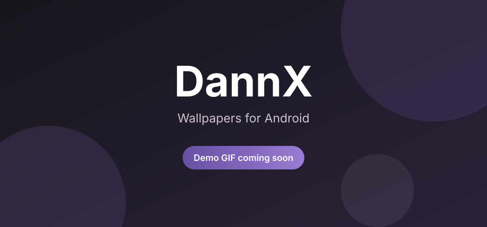

<h1 align="center">DannX</h1>

<p align="center">
  Fondos de pantalla para Android, hechos con Kotlin y Jetpack Compose.<br>
  Código abierto, sin anuncios, sin vueltas.
</p>

<p align="center">
  <a href="https://github.com/Lxchoooo/dannx/actions/workflows/android.yml"></a>
  <a href="https://github.com/Lxchoooo/dannx/releases/latest"></a>
  <a href="LICENSE"></a>
  
  
</p>

<p align="center">
  <strong>Español</strong> · <a href="README.md">English</a>
</p>

DannX es una app de fondos de pantalla para Android con un feed curado,
favoritos, colecciones y un editor integrado. Incluye un feed de ejemplo, así
que podés probarla apenas la instalás.

## 🎬 Demo

<!-- Reemplazar con el GIF real -->
<p align="center">
  
</p>

El GIF de demo está en camino. Las capturas del build actual se van a publicar
en [`docs/screenshots/`](docs/screenshots/) junto con la próxima versión.

## ✨ Características

### 🎨 Experiencia de usuario

- Animaciones fluidas con resortes y componentes Material 3 Expressive.
- **Modo Lite** para equipos viejos o con pocos datos: imágenes más livianas y
  menos movimiento.
- Haptics sutiles al actualizar, marcar favoritos y confirmar acciones.
- Temas claro y oscuro, color dinámico en Android 12+, ícono adaptativo y
  accesos directos en el launcher.
- Accesible: etiquetas para TalkBack, objetivos táctiles de 48 dp y texto que
  escala con el sistema.
- Bienvenida que se muestra una sola vez, interfaz en español e inglés y
  actualizador dentro de la app.

### 🗂 Explorar y organizar

- Fondos destacados, categorías y tags libres.
- Búsqueda que responde mientras escribís, con búsquedas recientes.
- Filtrá el feed por color con un toque, o por una o varias etiquetas; tocá el
  mismo chip otra vez para quitarlo.
- Pull-to-refresh y navegación sin conexión por el feed que ya cargaste.
- Favoritos y colecciones guardados en tu teléfono.
- **Sorprendeme** abre un fondo aleatorio del filtro actual.
- Detalle con zoom con dos dedos, doble toque y desplazamiento.
- Descargá a `Pictures/DannX`, aplicá en pantalla de inicio, bloqueo o ambas, o
  compartí cualquier fondo.

### 🔒 Privacidad

- Sin anuncios, sin analítica y sin SDKs de seguimiento.
- Los favoritos, las colecciones, los ajustes y la caché offline quedan en tu
  dispositivo.
- El catálogo público se obtiene de un servicio remoto; no hace falta una cuenta
  para explorarlo.

### 🖌 Editor integrado

- Recortá y encuadrá la imagen.
- Ajustes de color y filtros predefinidos.
- Desenfoque progresivo real.
- Deshacer y rehacer mientras editás.

## 🧰 Tech Stack

- **Kotlin**
- **Jetpack Compose** con **Material 3 Expressive**
- **Coil** para cargar imágenes
- **OkHttp** para la red
- **MVVM** con un único `UiState`

## ⬇️ Instalación

1. 📥 Abrí la página de [Releases](https://github.com/Lxchoooo/dannx/releases/latest).
2. 📲 Descargá el último `DannX.apk`.
3. 🛡️ Permití instalar desde orígenes desconocidos si Android te lo pide.
4. 🔄 Instalá encima de cualquier versión anterior. Se conservan favoritos,
   colecciones y ajustes.
5. ✅ Si querés, verificá la descarga con el archivo `DannX.apk.sha256` incluido
   en el release.

**Requisitos:** Android 10 (API 29) o superior.

## 🤝 Contribuir

¿Encontraste un bug o tenés una idea? Abrí un
[issue](https://github.com/Lxchoooo/dannx/issues) con los detalles. Los pull
requests son bienvenidos; los cambios chicos y enfocados son los más fáciles de
revisar.

Antes de mandar código, leé la
[guía en español](docs/i18n/CONTRIBUTING.es.md) o [CONTRIBUTING.md](CONTRIBUTING.md).
Al participar aceptás el
[Código de Conducta](docs/i18n/CODE_OF_CONDUCT.es.md).

¿Querés compilarla? Necesitás JDK 17 y el Android SDK:

```bash
./gradlew assembleDebug
```

## 🔐 Privacidad

DannX no incluye anuncios, analítica ni SDKs de seguimiento. Tus favoritos,
colecciones, ajustes y caché offline quedan en tu dispositivo. Mirá
[PRIVACY.es.md](PRIVACY.es.md) para el detalle.

## 🛡 Seguridad

Reportá las vulnerabilidades en privado siguiendo
[SECURITY.es.md](docs/i18n/SECURITY.es.md), no abras un issue público.

## 📄 Licencia

Publicado bajo la [licencia MIT](LICENSE).

## 🌟 ¿Te gusta la app?

Si DannX te sirve, una ⭐ en el repositorio ayuda a que más gente la encuentre.
Gracias por probarla, reportar bugs y sugerir ideas.

Hecha con cariño por [Lxchoooo](https://github.com/Lxchoooo) y quienes
contribuyen.
