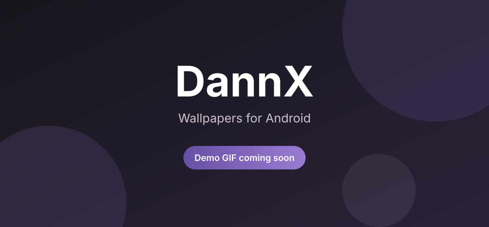

<h1 align="center">DannX</h1>

<p align="center">
  Wallpapers for Android, built with Kotlin and Jetpack Compose.<br>
  Open source, no ads, no fuss.
</p>

<p align="center">
  <a href="https://github.com/Lxchoooo/dannx/actions/workflows/android.yml"></a>
  <a href="https://github.com/Lxchoooo/dannx/releases/latest"></a>
  <a href="LICENSE"></a>
  
  
</p>

<p align="center">
  <a href="README.es.md">Español</a> · <strong>English</strong>
</p>

DannX is a wallpaper app for Android with a curated feed, favourites, collections
and a built-in editor. It ships with a demo feed, so you can try it right after
installing.

## 🎬 Demo

<!-- Reemplazar con el GIF real -->
<p align="center">
  
</p>

A short demo GIF is on the way. Screenshots for the current build will be
published in [`docs/screenshots/`](docs/screenshots/) with the next release.

## ✨ Features

### 🎨 User experience

- Smooth, spring-based animations and Material 3 Expressive components.
- **Lite mode** for older phones or limited data: lighter images and less motion.
- Subtle haptic feedback on refresh, favourites and confirmations.
- Light and dark themes, dynamic colour on Android 12+, an adaptive icon and
  home-screen shortcuts.
- Accessible by default: TalkBack labels, 48 dp touch targets and scalable text.
- One-time welcome flow, Spanish and English UI, and an in-app update check.

### 🗂 Explore and organise

- Featured wallpapers, categories and free-form tags.
- Search that keeps up as you type, with recent searches.
- Filter the feed by colour with a single tap, or by one or more tags; tap the
  same chip again to clear it.
- Pull to refresh, plus offline browsing of the feed you already loaded.
- Favourites and collections stored on your phone.
- **Surprise me** opens a random wallpaper from the current filter.
- Detail view with pinch zoom, double-tap zoom and pan.
- Download to `Pictures/DannX`, apply to the home screen, lock screen or both,
  or share any wallpaper.

### 🔒 Privacy

- No ads, no analytics and no tracking SDKs.
- Favourites, collections, settings and the offline cache stay on your device.
- The public catalogue is fetched from a remote service; no account is needed
  to browse it.

### 🖌 Built-in editor

- Crop and frame the image.
- Colour adjustments and filter presets.
- Real progressive blur.
- Undo and redo while you edit.

## 🧰 Tech Stack

- **Kotlin**
- **Jetpack Compose** with **Material 3 Expressive**
- **Coil** for image loading
- **OkHttp** for networking
- **MVVM** with a single `UiState`

## ⬇️ Install

1. 📥 Open the [Releases](https://github.com/Lxchoooo/dannx/releases/latest) page.
2. 📲 Download the latest `DannX.apk`.
3. 🛡️ Allow installs from unknown sources if Android asks.
4. 🔄 Install over any previous version. Favourites, collections and settings are
   kept.
5. ✅ Optionally verify the download with the `DannX.apk.sha256` file included in
   the release.

**Requirements:** Android 10 (API 29) or newer.

## 🤝 Contributing

Found a bug or have an idea? Open an
[issue](https://github.com/Lxchoooo/dannx/issues) with the details. Pull requests
are welcome; small, focused changes are the easiest to review.

Before sending code, read [CONTRIBUTING.md](CONTRIBUTING.md) or the
[Spanish guide](docs/i18n/CONTRIBUTING.es.md). By participating you agree to the
[Code of Conduct](CODE_OF_CONDUCT.md).

Want to build from source? You need JDK 17 and the Android SDK:

```bash
./gradlew assembleDebug
```

## 🔐 Privacy

DannX does not include ads, analytics or tracking SDKs. Your favourites,
collections, settings and offline cache stay on your device. Read
[PRIVACY.md](PRIVACY.md) for the details.

## 🛡 Security

Please report vulnerabilities privately by following [SECURITY.md](SECURITY.md)
instead of opening a public issue.

## 📄 License

Released under the [MIT License](LICENSE).

## 🌟 Like the app?

If DannX is useful to you, a ⭐ on the repository helps other people find it.
Thanks for trying it, reporting bugs and suggesting ideas.

Made with care by [Lxchoooo](https://github.com/Lxchoooo) and contributors.
